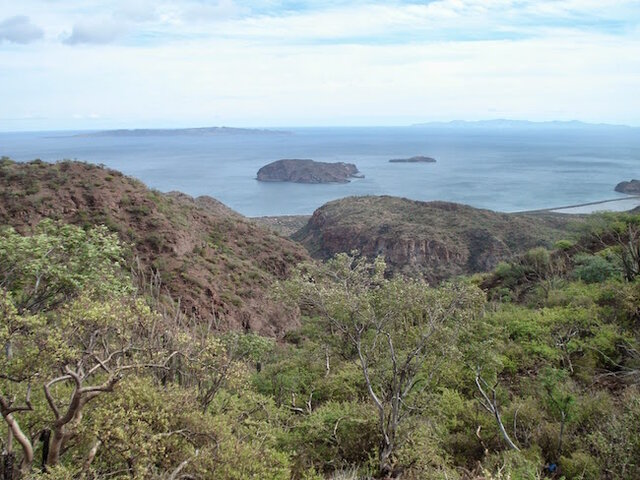
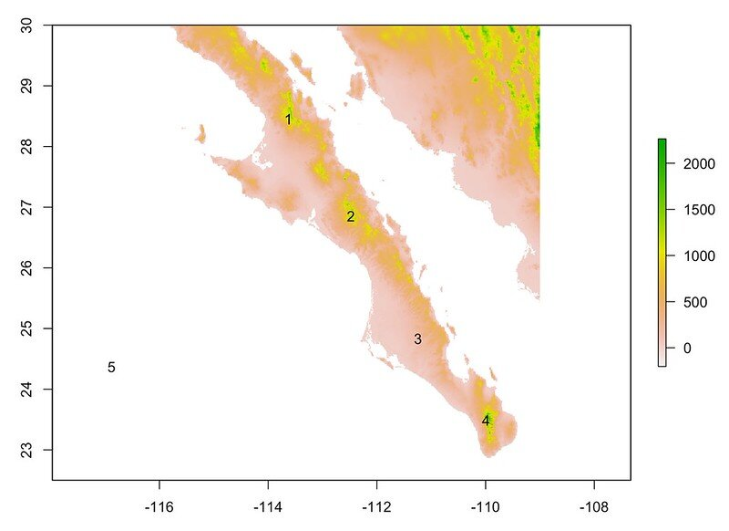
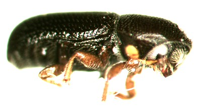
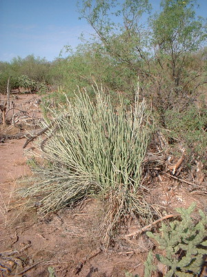

<!-- BEGIN module:header — generated from module.yml; edit that, not this -->

{fig-alt="The Sea of Cortez near Loreto, Baja California Sur."}

> Raster data is good for representing continuous surfaces and performing fast analyses on large areas, such as calculating a surface temperature map or a land-cover classification.

<!-- END module:header -->

All raster operations in this topic are accomplished using the `terra` library, the modern replacement for the older `raster` library.  If you run across older code online that uses `raster()`, `extent()`, or `projectRaster()`, the `terra` equivalents are `rast()`, `ext()`, and `project()`.

```{r}
library(terra)
```

Rasters are representations of continuous, or semi-continuous, data.  You can envision a raster just like an image.  <mark>When me make a `leaflet()` map and how the tiles, each pixel is colored a particular value representing elevation, temperature, precipitation, habitat type, or whatever.</mark>  This is exactly the same for rasters.  The *key point* here is that each pixel represents some defined region on the earth and as such the raster itself is georeferenced.  It has a coordinate reference system (CRS), boundaries, etc.

## Making Rasters *de novo*

A raster is simply a matrix with rows and columns and each element has a value associated with it.  You can create a raster *de novo* by making a matrix of data and filling it with values, then turning it into a raster.

Here I make a raster with random numbers selected from the Poisson Distribution (fishy, I know) using the `rpois()` function.  I then turn it into a matrix with 7 rows (and 7 columns).


```{r}
vals <- rpois(49, lambda=12)
x <- matrix( vals, nrow=7)
x
```

While we haven't used matrices much thus far, it is a lot like a `data.frame` with respect to getting and setting values using numerical indices.  For example, the value of the 3rd row and 5th column is:

```{r}
x[3,5]
```

To convert this set of data, as a matrix, into a geospatially referenced `SpatRaster` object we pass it to the `rast()` function:

```{r}
r <- rast( x )
r
```

Notice that when I plot it out, it does not show the data, but a summary of the data along with some key data about the contents, including:  
- A class definition (`SpatRaster`)
- The size of the underlying data matrix (rows, columns, and the number of layers),
- The resolution (e.g., the spatial extent of the sides of each pixel).  Since we have no CRS here, it is equal to $nrow(x)^{-1}$ and $ncol(x)^{-1}$.  
- The extent (the bounding box) and again since we do not have a CRS defined it just goes from $0$ to $1$.
- The `coord. ref.` (missing)
- The source, which is `memory` if the values are held in R or the name of the file the values are read from.

If these data represent something on the planet, we can assign the dimensions and `CRS` values to it and use it in our normal day-to-day operations.

## Loading Rasters from Files or URLs

We can also grab a raster object from the filesystem or from some online repository by passing the link to the `rast()` function.  Here is the elevation, in meters, of the region in which Mexico is found. To load it in, pass the url.

```{r}
url <- "https://dyerlabteaching.github.io/CourseData/Spatial/alt_22.tif"
r <- rast( url )
r
```

Notice that this raster has a defined CRS and as such it is projected and the extent relates to the units of the datum (e.g., from -120 to -90 degrees longitude and 0 to 30 degrees latitude).

If we plot it, we can see the whole raster.

```{r}
plot(r)
```

Now, this raster is elevation where there is land but where there is no land, it is full of `NA` values.  As such, there is a ton of them.

```{r}
format( sum( is.na( values(r) ) ), big.mark = "," )
```


## Cropping

One of the first things to do is to crop the data down to represent the size and extent of our study area.  If we have over 10 million missing data points (the ocean) and most of Mexico in this raster above but we are only working with sites in Baja California (Norte y Sur), we would do well to excise (or crop) the raster to only include the area we are interested in working with.  

To do this, we need to figure out a bounding box (e.g., the minimum and maximum values of longitude and latitude that enclose our data).  Let's assume we are working with the Beetle Data from the [Spatial Points Slides](https://dyerlabteaching.github.io/Spatial-Points/slides.html) and load in the Sex-biased dispersal data set and use those points as a starting estimate of the bounding box.


```{r}
library( sf )
library( tidyverse )
beetle_url <- "https://dyerlabteaching.github.io/CourseData/Spatial/AraptusDispersalBias.csv"

read_csv( beetle_url ) |>
  st_as_sf( coords=c("Longitude","Latitude"), crs=4326 ) -> beetles

summary( beetles )
```

Now, we can take the bounding box of these points and get a first approximation.

```{r}
beetles |> st_bbox()
```

OK, so this is the strict bounding box for these points.  This means that the minimum and maximum values for these points are defined by the original locations—for both the latitude and longitude (both minimum and maximum)—we have sites on each of the edges.  This is fine here but we could probably add a little bit of a *buffer* around that bounding box so that we do not have our sites on the very edge of the plot.  We can do this by either *eyeballing-it* to round up to some reasonable area around the points *or* apply a buffer (`st_buffer`) to the union of all the points with some distance and then take the bounding box.   I'll go for the former and make it into an extent object (a `SpatExtent`) using the `ext()` function.

```{r}
baja_extent <- ext( c(-116, -109, 22, 30 ) )
baja_extent
```

Then we can `crop()` the original raster using this extent object to create our working raster.  I can then dump my points onto the same raster plot by indicating `add=TRUE`.

```{r}
alt <- crop( r, baja_extent )
plot(alt)
plot( beetles["Suitability"], pch=16, add=TRUE)
```

::: {.callout-warning}
You need to be careful here.  When you use built-in graphics processes in a markdown document such as this and intend to add subsequent plots to an existing plot you **cannot** run the lines individually.  They **must** be all executed as the whole chunk.  So there is no `CTRL/CMD + RETURN` action here, it will plot the first one and then complain throughout the remaining ones saying something like `plot.new has not been called yet`.  So you have to either render the whole document or just run the whole chunk to get them to overlay.
:::

## Masking

There is another way to grab just a portion of the raster—similar to cropping—which is to mask.  A mask will not change the size of the raster but just put `NA` values in the cells that are not in the area of interest.  So if we were to just mask above, it would never actually reduce the size of the raster, just add a lot more `NA` values.  However, the setup is the same.  The one difference is that `terra` functions want their vector data as a `terra` vector object (a `SpatVector`) rather than an `sf` object, so we convert the hull with `vect()`[^1].

```{r}
beetles |>
  filter( Site != 32 ) |>
  st_union() |>
  st_buffer( dist = 1 ) |>
  st_convex_hull() -> hull

baja <- mask( alt, vect(hull) )
baja
```

And it looks like.

```{r}
plot(baja)
```


## Plotting with GGPlot

As you may suspect, our old friend `ggplot` has some tricks up its sleeve for us.  The main thing here is that `ggplot` requires a `data.frame` object and a raster is not a `data.frame` --- Unless we turn it into one (hehehe).  Remember from the [lecture on `data.frame` objects](https://dyerlabteaching.github.io/Data-Containers/narrative.html) that we can coerce other data containers into a `data.frame` using the `as.data.frame()` function.  The same works for a raster.  If we pass `xy=TRUE` it takes each cell of the raster (and underlying matrix), makes a row from it, and includes the coordinates of the center of that cell as the `x` and `y` columns.  By default, cells that are `NA` (the ocean) are dropped.

```{r}
alt |>
  as.data.frame( xy = TRUE ) |>
  head()
```

And this time it really is a `data.frame`.

```{r}
alt |>
  as.data.frame( xy = TRUE ) |>
  class()
```

So here it is in one pipe, using the following tricks:
- Converting the raster to a `data.frame` so it will go into `ggplot`
- Renaming the columns of data I am going to keep so I don't have to make `xlab` and `ylab`

```{r}
alt |>
  as.data.frame( xy = TRUE ) |>
  transmute(Longitude=x,
            Latitude=y,
            Elevation=alt_22)  -> alt.df
head( alt.df )
```

Then we can plot it by:  
- Plotting it using `geom_raster()` and setting the fill color to the value of elevation.
- Making the coordinates equal (e.g., roughly equal in area for longitude and latitude), and
- Applying only a minimal theme.


```{r}
alt.df |>
  ggplot()  + 
  geom_raster( aes( x = Longitude, 
                    y = Latitude, 
                    fill = Elevation) ) + 
  coord_equal() +
  theme_minimal() -> baja_elevation

baja_elevation
```


That looks good but we should probably do something with the colors.  The default dark-to-light blue gradient makes it hard to see differences in elevation and, as we will see below, blue usually means water on a map.  There is a built-in `terrain.colors()` function and we can tell `ggplot` to use it for the fill gradient.

```{r}
baja_elevation + 
  scale_fill_gradientn( colors=terrain.colors(100))
```


Better, but is it *good*?  Look at the yellow band in the middle.  It jumps out as if something important happens at that elevation, when it is really just where the palette changes hue.  The choice of palette changes what a reader sees in the data, so it is worth a few minutes of thought.

### Choosing a Color Palette

When we map a continuous value to color, we are asking the reader to translate color back into a number.  A good palette makes that translation easy and honest.  There are three things to look for.

- **Perceptual uniformity.**  Equal steps in the data should *look* like equal steps in color.  Palettes that pass through many hues (rainbows, and to a lesser extent `terrain.colors()`) have bright bands where the color seems to change quickly and muddy regions where it hardly seems to change at all.  Readers see boundaries in the bright bands that are not in the data.
- **Color vision deficiency.**  About 1 in 12 men and 1 in 200 women have some form of color blindness, most commonly difficulty separating red from green.  A palette that relies on red vs. green to show high vs. low is unreadable to them.
- **Grayscale.**  If someone prints your map in black and white, it should still go from dark to light (or light to dark) in order.

The kind of palette also needs to match the kind of data.

- **Sequential** palettes run from low to high in one direction (light to dark).  Use them for values with a natural order and no special middle, like elevation, precipitation, or population density.
- **Diverging** palettes run out in two directions from a neutral middle color.  Use them only when the middle *means* something, like zero change, an average, or sea level.
- **Qualitative** palettes are a set of distinct colors with no order.  Use them for categories like habitat type.

Elevation is sequential, so that is what we want here.  Fortunately, several palette families have been designed with all of this in mind, and they work with any `ggplot` (not just maps).

#### Viridis

The `viridis` palettes are built into `ggplot2`.  They are perceptually uniform, readable with the common forms of color blindness, and go from dark to light so they print well in grayscale.  The `_c` at the end of `scale_fill_viridis_c()` means *continuous* (there is also `_d` for discrete values and `_b` for binned ones).

```{r}
baja_elevation +
  scale_fill_viridis_c()
```

The `option` argument picks among several versions (`"viridis"`, `"magma"`, `"inferno"`, `"plasma"`, `"cividis"`, and a few more).

```{r}
baja_elevation +
  scale_fill_viridis_c( option = "magma" )
```

#### ColorBrewer

[ColorBrewer](https://colorbrewer2.org/) is a set of palettes designed by the cartographer Cynthia Brewer specifically for maps.  The website lets you filter palettes by type (sequential, diverging, qualitative) and by whether they are colorblind safe or print friendly.  In `ggplot` the palettes come in three versions: `scale_fill_brewer()` for discrete values, `scale_fill_distiller()` for continuous values, and `scale_fill_fermenter()` for binned values.

```{r}
baja_elevation +
  scale_fill_distiller()
```

The default is the sequential `"Blues"` palette (which, again, reads as water).  Pick another by name with the `palette` argument.  The `direction` argument (`1` or `-1`) flips which end of the palette goes with the low values.

```{r}
baja_elevation +
  scale_fill_distiller( palette = "YlOrBr" )
```

#### Scientific Colour Maps

The `scico` library provides the [Scientific Colour Maps](https://www.fabiocrameri.ch/colourmaps/) designed by Fabio Crameri.  They were made in response to how often misleading palettes show up in published figures, and every one of them is perceptually uniform and readable with color vision deficiency.

```{r}
library( scico )
```

```{r}
baja_elevation +
  scale_fill_scico()
```

The `palette` argument picks among several dozen palettes, including diverging ones like `"vik"`.

```{r}
baja_elevation +
  scale_fill_scico( palette = "vik" )
```

This is a good example of a technically nice palette used for the wrong kind of data.  `"vik"` is diverging, so the neutral middle color lands on whatever elevation is halfway between the minimum and maximum (about 1000m here) and the map suggests that elevations are *above* or *below* something.  Nothing special happens at 1000m.  If we were mapping elevation relative to sea level (with `midpoint = 0`) or the change in temperature since 1950, a diverging palette would be just right.

#### Rolling Your Own

You can also build a gradient from colors you choose.  `scale_fill_steps()` goes from a `low` to a `high` color but bins the values into a handful of classes.  Binning gives up some detail, but it makes it much easier to read an actual value off the map, much like the contour bands on a topographic map.

```{r}
baja_elevation +
  scale_fill_steps( low = "springgreen4",
                    high = "yellow" )
```

Or, you can set up your own diverging gradient using `low`, `mid`, and `high` colors and then tell it where the midpoint is along that gradient and it will *do the right thing<sup>&copy;</sup>*.  Here I am not claiming that 1000m is special; I am mimicking the green-lowland, brown-mountain convention of a topographic map.

```{r}
baja_elevation + 
  scale_fill_gradient2( low = "darkolivegreen",
                        mid = "yellow",
                        high = "brown", 
                        midpoint = 1000 ) -> baja_map
baja_map
```

Now that looks great.  Now, how about overlaying the points onto the plot and indicating the size of the point by the **♂♀** ratio.

```{r}
#| message: false
baja_map + 
  geom_sf( aes(size = MFRatio ), 
           data = beetles, 
           color = "dodgerblue2",
           alpha = 0.75)
```
Now that looks nice.

## Plotting with `tidyterra`

Converting the raster into a `data.frame` works, and it is worth knowing how to do because it shows exactly what `ggplot` needs.  It is, however, a bit clunky.  We had to make a second copy of the data (`alt.df`), rename the columns by hand, and remember to add `coord_equal()`.  The `tidyterra` library is a bridge between `terra` and the `tidyverse` that takes care of all of this for us.

```{r}
library( tidyterra )
```

It helps in three main ways.

### 1. `geom_spatraster()` plots the raster directly

Instead of converting to a `data.frame` and using `geom_raster()`, we hand the `SpatRaster` itself to `geom_spatraster()`.

```{r}
ggplot() +
  geom_spatraster( data = alt ) +
  theme_minimal()
```

Notice what we did *not* have to do:

- No `as.data.frame()` and no extra copy of the data.
- No `coord_equal()`.  Since the raster knows its CRS, `geom_spatraster()` uses `coord_sf()` and we get proper longitude and latitude labels on the axes, just like `geom_sf()`.
- No worrying about size.  This raster has over 800,000 cells, and `geom_spatraster()` automatically resampled it down to about 500,000 for drawing (that is the `resampled to ... cells` message) so that plotting does not take forever.  The raster itself is not changed.

The ocean cells are `NA` and get plotted as gray by default.  Every `scale_fill_*()` function takes a `na.value` argument and setting `na.value = NA` makes them transparent.

### 2. Color scales made for maps

The default blue gradient in that plot is not wrong, but it does not *read* as elevation.  Low and high ground are just darker and lighter blue, and blue usually means water on a map.  Readers of maps already know a convention for elevation—greens for lowlands, tans and browns for hills and mountains, white for the peaks—and using it lets them read the terrain without studying the legend.

`tidyterra` comes with color scales designed for maps that follow these conventions.  For elevation, the hypsometric scales (`scale_fill_hypso_c()`) use the colors you see on printed topographic maps, and the `scale_fill_whitebox_c()` and `scale_fill_wiki_c()` scales have several more.  Here I set the legend title with `labs()` since the raster layer is still named `alt_22`.

```{r}
ggplot() +
  geom_spatraster( data = alt ) +
  scale_fill_hypso_c( palette = "etopo1_hypso",
                      na.value = NA ) +
  labs( fill = "Elevation (m)" ) +
  theme_minimal() -> baja_hypso

baja_hypso
```

Because this is just a `ggplot` object, we can overlay the beetle data exactly the same way as before.

```{r}
#| message: false
baja_hypso +
  geom_sf( aes(size = MFRatio ),
           data = beetles,
           color = "dodgerblue4",
           alpha = 0.75)
```

### 3. `dplyr` verbs work on rasters

This is the big one.  Look back at what we have had to do to change anything about the raster's data.  Its single layer is still named `alt_22` (the name of the file, not a description), so we renamed it inside `transmute()` when making `alt.df` and again with `labs()` for the legend.  Without `tidyterra`, renaming the layer itself means `names(alt) <- ...`, computing a new layer means raster algebra, and picking out cells means indexing into `values()` (we will see that in the *Applications* section).  Those are three different idioms, none of which look like the `dplyr` code we write for everything else.

With `tidyterra` loaded, many of the `dplyr` verbs we already know—`rename()`, `select()`, `mutate()`, `filter()`—work directly on a `SpatRaster`, treating each layer as a column and each cell as a row.  *And they give back a `SpatRaster`*, so we never leave the raster world.

For example, let's give that layer a better name than `alt_22` once, so every later plot and filter can just say `Elevation`.

```{r}
alt |>
  rename( Elevation = alt_22 ) -> baja_elev
baja_elev
```

Or, if we needed to share a map with a collaborator (or a U.S. agency) that works in feet rather than meters, make a new layer with the elevation in feet.

```{r}
baja_elev |>
  mutate( Feet = Elevation * 3.28084 )
```

Notice that the result has two layers now (`nlyr` is 2), one for each "column".  A single `SpatRaster` can hold many layers that share the same grid, such as elevation, temperature, and precipitation for the same cells, or the same variable measured in different years.  Base `plot()` draws one panel per layer.

```{r}
baja_elev |>
  mutate( Feet = Elevation * 3.28084 ) |>
  plot()
```

We will put `filter()` to work in the *Applications* section below.

## Downloading Rasters with `geodata`

So far, the only raster we have used is the elevation file from the course data site.  For real projects, you will usually need some other variable (climate, land cover, soils) for your own study area, and finding, downloading, and unpacking those files by hand from each data provider gets old fast.  The `geodata` library takes care of this for many of the most commonly used *global* data sets, downloading them straight into `SpatRaster` (or, for boundaries, `SpatVector`) objects.

```{r}
library( geodata )
```

Some of the data sets it can fetch are:

| Data | Functions |
|---|---|
| Current climate (WorldClim) | `worldclim_global()`, `worldclim_country()`, `worldclim_tile()` |
| Future climate projections (CMIP6) | `cmip6_world()`, `cmip6_tile()` |
| Elevation | `elevation_global()`, `elevation_30s()` |
| Land cover, soils, and the human footprint | `landcover()`, `soil_world()`, `footprint()` |
| Political boundaries (as vectors) | `gadm()` |

### The Bioclim Variables

Climate is one of the first things an ecologist wants to know about a site, and monthly averages of temperature and rainfall are hard to work with directly (24 numbers per location, before you even ask about variability).  The [WorldClim](https://www.worldclim.org/data/bioclim.html) data set (Fick & Hijmans 2017[^worldclim]) boils the monthly values down into 19 *bioclimatic* variables that describe the annual averages, the seasonality, and the extremes (the hottest month, the driest quarter, etc.) that tend to limit where species can live.  This is why they are a staple of species distribution modeling.  The current version (2.1) summarizes the climate from 1970–2000.

[^worldclim]: Fick, S.E. and R.J. Hijmans, 2017. WorldClim 2: new 1km spatial resolution climate surfaces for global land areas. *International Journal of Climatology* 37 (12): 4302–4315.

| Variable | Description |
|---|---|
| BIO1 | Annual Mean Temperature |
| BIO2 | Mean Diurnal Range (mean of monthly (max temp − min temp)) |
| BIO3 | Isothermality (BIO2/BIO7 × 100) |
| BIO4 | Temperature Seasonality (standard deviation × 100) |
| BIO5 | Max Temperature of Warmest Month |
| BIO6 | Min Temperature of Coldest Month |
| BIO7 | Temperature Annual Range (BIO5 − BIO6) |
| BIO8 | Mean Temperature of Wettest Quarter |
| BIO9 | Mean Temperature of Driest Quarter |
| BIO10 | Mean Temperature of Warmest Quarter |
| BIO11 | Mean Temperature of Coldest Quarter |
| BIO12 | Annual Precipitation |
| BIO13 | Precipitation of Wettest Month |
| BIO14 | Precipitation of Driest Month |
| BIO15 | Precipitation Seasonality (Coefficient of Variation) |
| BIO16 | Precipitation of Wettest Quarter |
| BIO17 | Precipitation of Driest Quarter |
| BIO18 | Precipitation of Warmest Quarter |
| BIO19 | Precipitation of Coldest Quarter |

Temperatures are in °C and precipitation is in mm.

### Downloading a Tile

WorldClim comes at several resolutions.  The finest is 30 arc-seconds (1/120 of a degree, about 1km at the equator), which is the same resolution as our elevation raster.  At that resolution a single global layer is very large, so `geodata` also offers it in 30° × 30° *tiles*.  To get one, `worldclim_tile()` needs the variable (`"bio"` for all 19 bioclim layers), any longitude and latitude that falls inside the tile you want, and a `path` (folder) to save the file in.

```{r}
bio <- worldclim_tile( var = "bio",
                       lon = -112,
                       lat = 26,
                       path = "cache" )
bio
```

A few things to notice:

- The result is a single `SpatRaster` with 19 layers, named `bio_1` through `bio_19`.
- The tile is about 126 MB, so the first download takes a while.  `geodata` checks `path` first and only downloads the file if it is not already there, so after the first time it loads instantly.  On your own machine, use a `data/` folder in your project for `path`.
- WorldClim's terms of use do not allow redistributing the data, so do not commit those files to GitHub.  Add the folder to your `.gitignore` and let `geodata` download them for anyone who runs your code.
- The extent and resolution are exactly the same as `alt_22`, so the cells line up one-to-one.

Because the grids match, we can use the same `baja_extent` from before to crop it, and `select()` from `tidyterra` to keep just the layers we want: annual mean temperature (`bio_1`) and annual precipitation (`bio_12`).

```{r}
bio |>
  crop( baja_extent ) |>
  select( bio_1, bio_12 ) -> baja_bio
plot( baja_bio )
```

Precipitation is a sequential variable, and on a map blue reads as water, which here is exactly what we want.  The `"YlGnBu"` ColorBrewer palette with `direction = 1` puts the wettest places in dark blue.

```{r}
ggplot() +
  geom_spatraster( data = baja_bio,
                   aes( fill = bio_12 ) ) +
  scale_fill_distiller( palette = "YlGnBu",
                        direction = 1,
                        na.value = NA ) +
  labs( fill = "Annual\nPrecipitation (mm)" ) +
  theme_minimal()
```

Most of the peninsula gets less than 250mm of rain a year.  The wettest parts are the Sierra de la Laguna at the southern tip and the mountains on the mainland side of the Gulf.

## Identifying Points

You can get some information from a raster plot interactively by using the `click` function.  This **must** be done with an active raster plot.  After that, you use the `click()` function to grab what you need.  Your mouse will turn from an arrow into a cross hair and you can position it where you like and get information such as the coordinates (spatial) of the point and the value of the raster pixel at that location.

The `n=` argument sets how many points to collect (it defaults to 10); you can stop early by pressing `ESC`.  If you set `id=TRUE` it will plot the number of the point onto the map so you can see where you had clicked.  Since this is interactive, you will not see the process when you execute the code below, but it will look like this:

```{r}
#| eval: false
plot( alt )
click(alt, xy=TRUE, n=3 ) -> points
```


```{r}
#| echo: false
points <- data.frame( x = c(-113.6292, -112.4792, -111.2458, -109.9958),
                      y = c(28.45417, 26.85417, 24.83750, 23.48750),
                      alt_22 = c(870, 1185, 135, 1145) )
```

Here is what the points look like.

```{r}
points
```

I'm going to rename the column names.

```{r}
points |>
  transmute( Longitude = x,
             Latitude = y,
             Value = alt_22) -> sites
```

And then I can plot those points (using `geom_point()`) onto our background map.

```{r}
baja_map + 
  geom_point( aes(x = Longitude,
                  y = Latitude, 
                  size = Value), data=sites, color="red") 
```

Mexellent! 

## Reprojecting Rasters 

Our raster is in longitude and latitude, whose units are degrees.  Degrees are fine for saying *where* something is, but they are a poor ruler: a degree of longitude is about 111 km wide at the equator and shrinks to nothing at the poles.  If we want to measure distances or areas (e.g., how much land lies within an elevation band), we want a projected coordinate system whose units are meters.

Just like points, we can reproject the entire raster using the `project()` function.  Here I am going to project the raster into UTM Zone 12N, a common projection for this part of [Mexico from epsg.io](https://epsg.io/6367).

The `terra` library understands EPSG codes, so all we need is the code for that projection (6367) written as a character string.

```{r}
new.proj <- "EPSG:6367"
```

Then we pass it to the `project()` function as the new `CRS`.

```{r}
#| message: false
#| warning: false
alt.utm <- project( alt, new.proj )
plot( alt.utm, xlab="Easting", ylab="Northing" )
```

Easy.

Notice that the axes are now Easting and Northing in meters.  That raises a problem as soon as we want to put the beetles back on the map: the beetle points are still in longitude and latitude (EPSG:4326), but the raster is now in UTM (EPSG:6367).

::: {.callout-note title="ggplot aligns coordinate systems automatically; base `plot()` does not"}

**Base `plot()` with `add=TRUE` does not work here.**  It does not look at the CRS of either object, it just draws numbers.  A beetle at longitude -113, latitude 27 gets drawn at 27 meters north of the equator, far below the bottom of this map (which starts around 2,400,000 m).  There is no error and no warning; the points silently disappear (left panel).  To make it work, you have to reproject the points to match the raster yourself with `st_transform()` *before* adding them (right panel).

```{r}
#| layout-ncol: 2
plot( alt.utm, main = "Without reprojecting" )
plot( st_geometry(beetles), add = TRUE, col = "red", pch = 16 )

plot( alt.utm, main = "After st_transform()" )
beetles |>
  st_transform( crs = 6367 ) |>
  st_geometry() |>
  plot( add = TRUE, col = "red", pch = 16 )
```

**`ggplot` does this for you.**  Every layer that knows its CRS (`geom_sf()`, `geom_spatraster()`, `geom_spatvector()`) is reprojected on the fly to match the CRS of the first layer.  We can stack the UTM raster and the longitude/latitude beetles as-is, with no `st_transform()` and nothing to remember.

:::

Here is the `ggplot` version, with the beetles left in longitude and latitude.

```{r}
#| message: false
ggplot() +
  geom_spatraster( data = alt.utm ) +
  geom_sf( data = beetles,
           color = "red" ) +
  scale_fill_hypso_c( na.value = NA ) +
  labs( fill = "Elevation (m)" ) +
  theme_minimal()
```

The beetles land exactly where they should.  Notice also the slight tilt in the grid lines.  `ggplot` labels the graticule in degrees, but lines of longitude are not parallel in UTM, which is exactly what we would expect.


## Applications

OK, so now we can make and show a raster but what about doing some operations?  A raster is just a matrix *decorated* with more geospatial information.  This allows us to do normal `R` like data manipulations on the underlying data.  Let's put that to work on two research questions from the Baja California data.

### Research Question 1: The Elevation Envelope of *Araptus attenuatus*

{fig-alt="The bark beetle Araptus attenuatus." width="50%"}

The beetle data we have been plotting come from 31 sites sampled for the bark beetle *Araptus attenuatus*, and `MFRatio` is the ratio of males to females at each site.  Two questions we might ask are:

1. What is the elevation *envelope* for this species?  That is, over what range of elevations do we find it, and how does that compare to the elevations available on the landscape?  
2. Is there any indication that elevation is related to sex bias (`MFRatio`)?

The beetle data do not include elevation, but the raster does.  So the general outline is:

1. Extract the elevation from the raster at each of the sites.  
2. Compare the elevations at the sites to the elevations across the whole landscape.  
3. Test for a relationship between `MFRatio` and elevation.

#### Extracting Values at the Sites

Pulling the value of a raster out at a set of points is done with the `extract()` function from the `terra` library.  Just like masking, this function wants a `SpatVector` rather than an `sf` object, so we convert the points with `vect()`.  It returns a `data.frame` with one row per point (in the same order as the points) and a column for the value of each raster layer at that point.  By default it also adds an `ID` column numbering the points; since we just want the values, `ID = FALSE` drops it.

```{r}
site_elev <- terra::extract( baja_elev, vect(beetles), ID = FALSE )
head( site_elev )
```

::: {.callout-warning title="Watch for masked functions"}
In the above code, I used the function `extract()` to extract the data from the `baja_elev` raster at the beetle sites.  However, there is also an `extract()` function that has been brought in from the `tidyr` library (as part of `tidyverse`).  In this file, I loaded `library(terra)` before `library(tidyverse)` and as such the `tidyr::extract()` function has overridden the one from `terra`—they cannot *both* be available.  As a consequence, I use the full name of the function with `package::function` when I call it as `terra::extract()` to remove all ambiguity.  If I had not, I got a message saying something like, `Error in UseMethod("extract") : no applicable method for 'extract' applied to an object of class "SpatRaster"`.  Now, I know there is an `extract()` function in `terra` so this is the **dead giveaway** that it has been overwritten by a subsequent library call.
:::

Because the rows are in the same order as the beetle sites, we can add the elevation to the beetle data as a new column.

```{r}
beetles |>
  mutate( Elevation = site_elev$Elevation ) -> beetles

beetles |>
  select( Site, MFRatio, Elevation )
```

#### Visualizing the Elevation Envelope

The simplest description of the envelope is the range of elevations at the sites.

```{r}
summary( beetles$Elevation )
```

So the beetles were found from `r min(beetles$Elevation)`m to `r max(beetles$Elevation)`m.  On its own, though, that range does not tell us much.  If most of the peninsula were below `r max(beetles$Elevation)`m, the beetles would just be living where the land is.  To see whether the species occupies a *subset* of what is available, we need to compare the sites to the landscape as a whole.  We can get every land cell as a `data.frame` with `as.data.frame()` and overlay the density of elevations across the landscape with the density at the beetle sites (the rug along the bottom marks each site).

```{r}
baja_elev |>
  as.data.frame() -> landscape

ggplot() +
  geom_density( aes( x = Elevation, fill = "Landscape" ),
                data = landscape,
                alpha = 0.5 ) +
  geom_density( aes( x = Elevation, fill = "Beetle Sites" ),
                data = beetles,
                alpha = 0.5 ) +
  geom_rug( aes( x = Elevation ),
            data = beetles ) +
  labs( fill = NULL,
        x = "Elevation (m)",
        y = "Density" ) +
  theme_minimal()
```

The two distributions overlap through the lowlands, but the landscape has a long tail of higher elevations that the beetles never reach.  About `r round( 100 * mean( landscape$Elevation > max(beetles$Elevation) ) )`% of the land in this area is higher than the highest beetle site, reaching up to `r max(landscape$Elevation)`m.  So the envelope for *A. attenuatus* is the lowland and mid-elevation part of the peninsula.

#### Elevation and Sex Ratio

For the second question, a scatter plot is the place to start.

```{r}
beetles |>
  ggplot( aes( x = Elevation, y = MFRatio ) ) +
  geom_point( size = 3 ) +
  labs( x = "Elevation (m)",
        y = "Male:Female Ratio" ) +
  theme_minimal()
```

There is no obvious trend.  We can quantify that with a correlation test (we will go into correlation in much more depth in a later topic).

```{r}
fit <- cor.test( beetles$MFRatio, beetles$Elevation )
fit
```

The correlation between sex ratio and elevation is weak ($\rho =$ `r format( fit$estimate, digits = 2 )`) and not significant ($P =$ `r format( fit$p.value, digits = 2 )`), so there is no evidence that sex bias in this species is related to elevation.


### Research Question 2: An Elevation Transect Across the Peninsula

The site `const` sits on the broad Pacific-side plain near Ciudad Constitución and site `169` is on the Gulf of California coast, about 130km to the north-northeast.  Between them is the Sierra de la Giganta.  From Research Question 1 we know that none of the sampled beetle sites is above `r max(beetles$Elevation)`m, which raises a question about how the landscape connects these two sites.

> Does the terrain between `const` and `169` rise above the elevation envelope of *A. attenuatus*, and if so, for how far?

To answer this we need an elevation *profile*: the elevation at regular steps along a straight line from one site to the other, plotted against the distance traveled.  The general outline is:

1. Pull out the two sites and connect them with a line (the transect).  
2. Put evenly spaced points along that line.  
3. Extract the elevation at each point and record how far it is from the start.  
4. Plot elevation against distance, along with the top of the beetle's envelope.

#### Building the Transect

First, we grab the two sites.  The order matters, since the profile will start at the first one, so I make `Site` a factor with `const` as the first level and sort by it.  This makes the order explicit rather than depending on the order of the rows in the original file.

```{r}
beetles |>
  filter( Site %in% c("const", "169") ) |>
  mutate( Site = factor( Site, levels = c("const", "169") ) ) |>
  arrange( Site ) -> ends
ends
```

To connect them, `st_combine()` merges the two points into a single geometry (keeping their order) and `st_cast()` changes that geometry from a set of points into a line.

```{r}
ends |>
  st_combine() |>
  st_cast( "LINESTRING" ) -> transect
transect
```

Before going any further, it is worth making sure the transect goes where we think it does.  I zoom in on the middle of the peninsula with `coord_sf()`.

```{r}
#| message: false
ggplot() +
  geom_spatraster( data = baja_elev ) +
  scale_fill_hypso_c( na.value = NA ) +
  geom_sf( data = transect,
           color = "red",
           linewidth = 1 ) +
  geom_sf_label( aes( label = Site ),
                 data = ends,
                 nudge_x = 0.3 ) +
  coord_sf( xlim = c(-113, -110),
            ylim = c(24, 27.5) ) +
  labs( x = NULL, y = NULL,
        fill = "Elevation (m)" ) +
  theme_minimal()
```

#### Sampling Along the Transect

Now we need points along the line.  We want them at a fixed distance apart, and distances should be in meters, not degrees (see *Reprojecting Rasters* above).  So we first project the transect into UTM, then use `st_line_sample()` to drop a point every 500m (`density = 1/500` is one point per 500 map units, which are meters in UTM).  The cells in our raster are a bit under 1km on a side, so a 500m step means we will not skip over any cells along the way.  `st_line_sample()` returns all of the points as a single multipoint geometry, so `st_cast()` splits them back into individual points.

```{r}
transect |>
  st_transform( crs = 6367 ) |>
  st_line_sample( density = 1/500 ) |>
  st_cast( "POINT" ) -> transect_pts
transect_pts
```

Since the points are now in UTM, we extract from the UTM version of the raster (`alt.utm`) so the two match.  For the distance, `st_distance()` measures from every point to the first one (in meters, which I convert to kilometers).  I put both into a `tibble` for plotting.

```{r}
tibble( Distance = as.numeric( st_distance( transect_pts, transect_pts[1] ) ) / 1000,
        Elevation = terra::extract( alt.utm, vect(transect_pts), ID = FALSE )$alt_22 ) -> profile
profile
```

#### The Elevation Profile

Finally, we plot the profile and add a dashed line at the elevation of the highest beetle site.

```{r}
profile |>
  ggplot( aes( x = Distance, y = Elevation ) ) +
  geom_area( fill = "tan", alpha = 0.6 ) +
  geom_line() +
  geom_hline( yintercept = max( beetles$Elevation ),
              linetype = "dashed",
              color = "red" ) +
  labs( x = "Distance from const (km)",
        y = "Elevation (m)" ) +
  theme_minimal()
```

The first 50km are the gently rising Pacific-side plain.  The Sierra de la Giganta then climbs to `r round( max(profile$Elevation) )`m before dropping steeply to the Gulf coast.  Since the points are 500m apart, we can estimate how much of the transect is above the envelope by counting points.

```{r}
profile |>
  filter( Elevation > max( beetles$Elevation ) ) |>
  summarize( Points = n(),
             Kilometers = n() * 0.5 )
```

So about `r sum( profile$Elevation > max(beetles$Elevation) ) * 0.5`km of the straight-line path between these sites is higher than any of the sampled beetle sites.  A straight line is not the only path between the two sites, of course, and a beetle would not have to go over the top of the ridge.  The profile tells us that a direct route crosses terrain outside the species' envelope, which is the kind of observation that leads to the next question: what parts of the landscape *are* connected?


### Research Question 3: Connectivity in *Euphorbia lomelii*

{fig-alt="Flowers of Euphorbia lomelii." width="50%"}

*Euphorbia lomelii* is pollinated by hummingbirds, and when it flowers is driven by elevation: plants within about 100m of each other in elevation flower at about the same time.  Pollen can only move between plants that are in flower at the same time, so the elevation band around any one population marks out which other parts of the landscape it can be connected to.

> What are the parts of Baja California that are within 100m of the elevation of site named *San Francisquito* (`sfran`)?  

To answer this, we have the following general outline of operations.

1. Find the coordinates of the site named `sfran`  
2. Extract the elevation from the `alt` raster that is within 100m (+/-) of that site.
3. Plot the whole baja data as a background  
4. Overlay all the locations within that elevation band.

To do this we will use both the `alt` and the `beetles` data objects.

First, we find out the coordinates of the site.

```{r}
sfran <- beetles$geometry[ beetles$Site == "sfran"]
sfran
```

Then we extract the elevation at that one point, exactly as we did for all of the sites above.

```{r}
terra::extract(alt, vect(sfran) )
```

So `sfran` is at 305m, and the band we are interested in runs from 205m to 405m.

#### Option 1 - Manipulate the Raster

To work on a raster directly, we can access the values within it using the `values()` function (I know, these statisticians/programmers are quite clever).

So, to make a copy and make only the values that are +/- 100m of `sfran` we can.

```{r}
alt_band <- alt
values( alt_band )[ values(alt_band) <= 205 ] <- NA
values( alt_band )[ values(alt_band) >= 405 ] <- NA
alt_band
```

Then we can plot overlay plots of each (notice how I hid the legend for the first `alt` raster).

```{r}
plot( alt, col="gray", legend=FALSE, xlab="Longitude", ylab="Latitude")
plot( alt_band, add=TRUE )
```


#### Option 2 - Manipulate the Data Frames

We can also proceed by relying upon the `data.frame` objects representing the elevation.  So let's go back to our `alt.df` object and use that in combination with a `filter` and plot both `data.frame` objects (the outline of the landscape in gray and the elevation range as a gradient).  I then overlay the beetle data with the ratios as sizes and label the locales with `ggrepel`.  Notice here that you can use the `sf::geometry` object from `beetles` if you pass it through the `st_coordinates` function as a statistical tranform making it regular coordinates and not `sf` objects (yes this is kind of a trick and hack but KEEP IT HANDY!).

```{r}
#| echo: true
library( ggrepel )
alt.df |>
  filter( Elevation >= 205,
          Elevation <= 405) |>
  ggplot() + 
  geom_raster( aes( x = Longitude,
                    y = Latitude),
               fill = "gray80", 
               data=alt.df ) + 
  geom_raster( aes( x = Longitude,
                    y = Latitude, 
                    fill = Elevation ) ) + 
  scale_fill_gradient2( low = "darkolivegreen",
                        mid = "yellow",
                        high = "brown", 
                        midpoint = 305 ) +
  geom_sf( aes(size=MFRatio), 
           alpha=0.5, 
           color="dodgerblue3", 
           data=beetles) +
  geom_text_repel( aes( label = Site,
                        geometry = geometry),
                   data = beetles,
                   stat = "sf_coordinates", 
                   size = 4, 
                   color = "dodgerblue4") + 
  coord_sf() + 
  theme_minimal() 
```


Very nice indeed.


#### Option 3 - Use `tidyterra` Verbs on the Raster

Option 1 kept the data as a raster but had us poking at `values()` with indices.  Option 2 let us use `filter()` but only after making a whole `data.frame` copy of the raster.  With `tidyterra`, we can get the best of both and `filter()` the raster itself.  Cells that do not meet the criteria are set to `NA` and the result is still a `SpatRaster`.

```{r}
baja_elev |>
  filter( Elevation >= 205,
          Elevation <= 405 ) -> elev_band
elev_band
```

If we plot only `elev_band`, the band floats in empty space and it is hard to tell where the coastline is or how the band sits on the peninsula.  Like Option 2, we want the rest of the land drawn in gray underneath as context.  We cannot just plot `baja_elev` with `fill = "gray80"`, though, because a constant fill colors the `NA` (ocean) cells as well and the whole map turns gray.  Instead, we turn the land into a polygon: `not.na()` makes a raster that is `1` on land and `0` in the ocean, `as.polygons()` turns each of those values into a polygon (a `SpatVector`), and `filter()` keeps the land one.  `tidyterra` provides `geom_spatvector()` to plot it.

```{r}
baja_elev |>
  not.na() |>
  as.polygons() |>
  filter( Elevation == 1 ) -> land
```

Then it is the same plot as Option 2, without the `data.frame`.

```{r}
#| warning: false
ggplot() +
  geom_spatvector( data = land,
                   fill = "gray80",
                   color = NA ) +
  geom_spatraster( data = elev_band ) +
  scale_fill_gradient2( low = "darkolivegreen",
                        mid = "yellow",
                        high = "brown",
                        midpoint = 305,
                        na.value = NA ) +
  geom_sf( aes(size=MFRatio),
           alpha=0.5,
           color="dodgerblue3",
           data=beetles) +
  geom_text_repel( aes( label = Site,
                        geometry = geometry),
                   data = beetles,
                   stat = "sf_coordinates",
                   size = 4,
                   color = "dodgerblue4") +
  labs( x = NULL, y = NULL ) +
  theme_minimal()
```

Which approach you use is up to you.  For quick looks, base `plot()` is hard to beat.  When you want a publication-quality map, `ggplot` with `tidyterra` lets you use everything you already know about the `tidyverse` and `ggplot` without converting your rasters into something else.


[^1]: A `SpatVector` is how `terra` represents points, lines, and polygons.  It holds the same kind of information as an `sf` object but is put together in a slightly different way.  We use `sf` for vector data in this course and convert with `vect()` only when handing something to a `terra` function.
